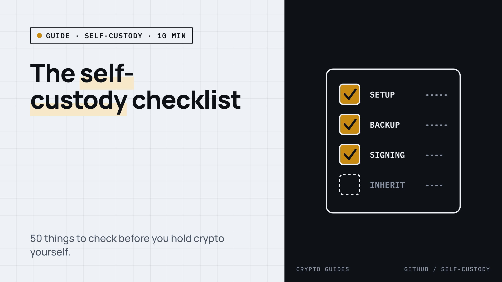
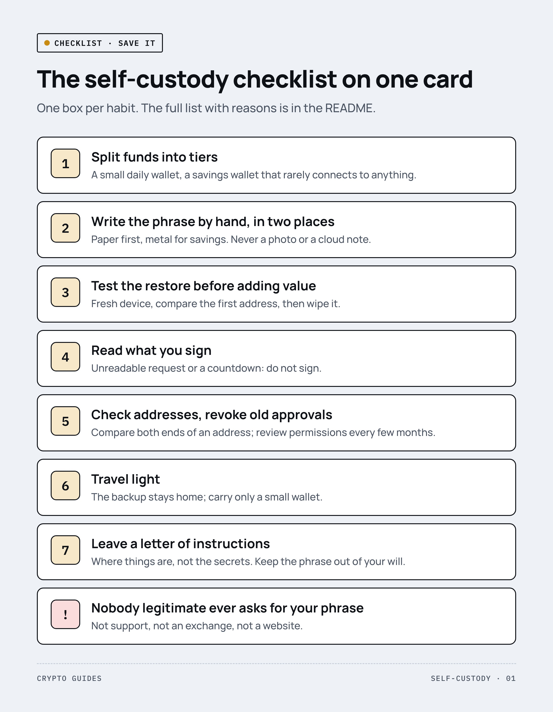

# The self-custody checklist: 50 things to check before you hold crypto yourself

**Setup, backups, daily use, signing, travel and inheritance as copyable task lists, each with a one-line reason.**

Holding your own crypto means nobody can freeze it, and nobody can restore it for you either. Most losses come from a short list of mistakes: a lost or leaked recovery phrase, a signature approved without reading it, an address copied from the wrong place. This checklist turns those into boxes you can tick.

Copy any section into your notes app, an issue or a printout. Each item has a short *why*, so you can drop the ones that do not apply to you instead of following rules blindly.

## Contents

- [The one-page card](#the-one-page-card)
- [1. Before you start](#1-before-you-start)
- [2. Setup](#2-setup)
- [3. Backups](#3-backups)
- [4. Daily use](#4-daily-use)
- [5. Signing and approvals](#5-signing-and-approvals)
- [6. Travel](#6-travel)
- [7. Inheritance basics](#7-inheritance-basics)
- [Choosing a wallet: honest limits](#choosing-a-wallet-honest-limits)
- [Deeper: why these rules exist](#deeper-why-these-rules-exist)
- [Sources](#sources)

## The one-page card

Save the card, then use the sections below for the full list.

## 1. Before you start

- [ ] **Decide what "self-custody" is for.** Savings you will not touch for a year need a different setup from spending money. *Why: one wallet cannot be both the safest and the most convenient.*
- [ ] **Split your funds into tiers.** For example: a small "daily" wallet, a larger "savings" wallet that rarely connects to anything. *Why: a drained daily wallet then costs you a coffee budget, not your savings.*
- [ ] **Write down your own rules before you buy.** How much goes where, who can know about it, what to do if a phone is lost. *Why: decisions made during a panic are worse.*
- [ ] **Check that the network and coin are supported.** The same coin name can exist on several networks at different addresses. *Why: sending to the wrong network is the classic unrecoverable mistake.*

## 2. Setup

- [ ] **Install the wallet from the official store page or the project's own site.** Compare the publisher name and the link from the project's website, not from a search ad or a message. *Why: fake wallet apps exist and ask for your phrase on first launch.*
- [ ] **Set up on a device you trust.** Updated system, no unknown profiles, no remote-control apps, no apps you do not recognise. *Why: a wallet is only as safe as the phone it runs on.*
- [ ] **Create the wallet yourself, offline from other people.** Nobody should see the screen when the phrase appears. *Why: whoever sees the phrase owns the wallet.*
- [ ] **Never accept a phrase someone else made for you.** A pre-made wallet from a seller or "helper" is not yours. *Why: they kept a copy.*
- [ ] **Set a device passcode and the wallet's own lock.** Use a long numeric code or a passphrase, not a birthday. *Why: it is the only barrier if the phone is taken.*
- [ ] **Turn on biometrics only if you accept the trade-off.** *Why: it is convenient, but a determined person can sometimes force a fingerprint. A passcode cannot be forced the same way.*
- [ ] **Do a first test transaction with a small amount.** Receive a small sum, send a small sum out. *Why: confirms you understand the address format and the fee.*
- [ ] **Note the network fee currency.** Most networks charge fees in their own coin, not the token you send. *Why: sending a stablecoin with no coin for fees fails.*

## 3. Backups

- [ ] **Write the recovery phrase on paper, by hand, at creation time.** Not a photo, not a screenshot, not a note. *Why: anything online can be copied; anything on the phone dies with the phone.*
- [ ] **Check each word against the spelling you see on screen.** *Why: one wrong letter cannot be fixed later.*
- [ ] **Make a second copy and store it in a different place.** A different building, not a different drawer. *Why: fire, flood and theft hit one place at once.*
- [ ] **Keep copies out of cloud storage, email, chat and password managers you do not control.** *Why: an account breach becomes a wallet breach.*
- [ ] **Consider a metal copy for savings.** Stainless steel or titanium plates survive fire and water better than paper. *Why: paper is the weakest part of most backups.*
- [ ] **Do not split the phrase into halves yourself.** *Why: each half leaks information and one lost half means no recovery. If you need splitting, use a scheme made for it (see the companion seed-phrase-handbook repository).*
- [ ] **Write down the extras, separately.** Wallet name, which networks, whether you used an extra passphrase ("25th word"). *Why: restoring is easier with context. Keep this note apart from the phrase.*
- [ ] **Test the backup before the wallet holds real value.** Restore on a second device or a fresh install, compare the first address, then wipe it. *Why: a backup you never tested is a hope, not a backup.*
- [ ] **If you use a passphrase, back it up as carefully as the phrase.** *Why: a wrong or forgotten passphrase gives a different, empty wallet. No error message appears.*
- [ ] **Re-check the backup once a year.** Is it readable, dry, still where you left it? *Why: ink fades, people move house.*

## 4. Daily use

- [ ] **Copy the address, then compare the first and last characters in the app that sends.** *Why: clipboard malware swaps addresses, and lookalike addresses imitate the start and end of one you know.*
- [ ] **Send a small test amount first to a new address.** *Why: a fee is cheaper than a mistake on a large payment.*
- [ ] **Never copy a recipient from your own transaction history without checking.** *Why: "address poisoning" sends you tiny transfers from lookalike addresses so they land in your history.*
- [ ] **Read the amount, the network and the fee on the confirmation screen.** *Why: that screen is your last chance to catch a mistake.*
- [ ] **Keep only spending money in the daily wallet.** *Why: it is the one most exposed to apps, sites and phishing.*
- [ ] **Keep the app and the system updated.** *Why: updates close known holes.*
- [ ] **Do not use public Wi-Fi for large transfers.** *Why: it adds risk for little benefit. Use mobile data.*
- [ ] **Do not talk about your holdings in public.** *Why: attackers choose targets by what they know. A physical threat is a real risk for large holders.*
- [ ] **Ignore support "agents" who write to you first.** *Why: real wallet support never asks for your phrase.*

## 5. Signing and approvals

- [ ] **Read what you sign.** A good wallet explains the action in words. If the request is unreadable hex, do not sign. *Why: signing is the only moment you give permission.*
- [ ] **Reject surprise requests.** A signature request that appears after you open a link, or with a countdown, is a warning sign. *Why: urgency is how scams work.*
- [ ] **Use a burner wallet with little money to try new sites.** *Why: if a site is malicious, only the burner is at risk.*
- [ ] **Prefer exact approval amounts when a site offers it.** *Why: "unlimited" permissions stay open after you leave the site.*
- [ ] **Review token approvals every few months, and revoke what you do not use.** Many wallets and block explorers show them. *Why: an old approval to a contract that gets hacked can drain tokens.*
- [ ] **Never sign a message that asks for your phrase or a private key.** *Why: no legitimate site needs either.*
- [ ] **Check the site address, character by character, from a bookmark.** *Why: phishing sites copy the design exactly.*
- [ ] **Disconnect sites when you finish.** *Why: a stale connection can send you requests later.*
- [ ] **Treat "free" tokens that appear in your wallet as hostile.** Do not interact with them. *Why: some carry links to drainers.*

## 6. Travel

- [ ] **Know the rules of the country you enter.** Rules on crypto and on device searches vary. *Why: assumptions break at borders.*
- [ ] **Do not carry the paper or metal backup with you when you can avoid it.** *Why: if you lose the phone, you restore at home from the backup. Carrying both means losing both.*
- [ ] **Take a wallet with a small amount if you need funds abroad.** Keep savings home. *Why: limits the loss from theft or a forced unlock.*
- [ ] **Keep the phone's system and the wallet app updated before you leave.** *Why: you will not want to update on hotel Wi-Fi.*
- [ ] **Do not use hotel computers or charging kiosks for anything that signs.** *Why: unknown hardware is not yours.*
- [ ] **Have a way to restore if the phone is lost.** Someone at home who knows where the instructions are. *Why: a lost phone abroad should be an inconvenience.*

## 7. Inheritance basics

- [ ] **Decide who, if anyone, should be able to recover your funds.** *Why: with self-custody there is no "forgot password" for your family.*
- [ ] **Write a letter of instructions that explains where things are, not the secrets themselves.** *Why: it is useful without being dangerous if found.*
- [ ] **Do not put the recovery phrase in a will.** *Why: a will can become a public record in many places.*
- [ ] **Tell one trusted person that the funds exist and where to start.** *Why: nobody can recover what they do not know about.*
- [ ] **Explain how a wallet works to that person, with a test.** *Why: your family may never have used one.*
- [ ] **Consider a lawyer for a will that covers digital assets.** *Why: law differs by place and is not covered in this guide.*
- [ ] **Review all this once a year.** *Why: people, phones and plans change.*

## Choosing a wallet: honest limits

The checklist works with any non-custodial wallet. Wallets such as MetaMask, Phantom, Trust Wallet or [Tint Wallet](https://tint.top/wallet/) differ in which networks they support and how much they explain before you sign. Check these before you pick one:

| Question | Why it matters |
|---|---|
| Is it self-custody (no account, the phrase is made on your device)? | Otherwise someone else holds the keys. |
| Which networks and tokens does it hold? | Wrong network, lost funds. |
| Does it support a hardware wallet? | A hardware device keeps keys off the phone. |
| Has it had an independent security audit? | |
| Is the source code public? | |
| Does it show a plain-language summary before you sign? | Reduces blind signing. |

Be honest about limits when you choose. Tint Wallet, for example, has no hardware-wallet support, has not had an independent security audit yet and its source code is not public. If you want hardware-grade protection for savings, a hardware wallet is the better tool for that tier. That is fine: use each wallet for what it is good at.

## Deeper: why these rules exist

Why the recovery phrase is the whole wallet

A BIP39 recovery phrase encodes 128 to 256 bits of random data. A wallet turns it into a seed and, from the seed, into every private key it will ever use. Whoever has the words can recreate all keys on any device. There is no server where a lost phrase can be reset. The companion seed-phrase-handbook repository explains the construction.

Why unlimited token approvals matter

On Ethereum-style networks, a token contract keeps a table: *owner, spender, amount*. An approval writes an allowance for the spender. A dapp or swap often asks for the maximum possible value so that it does not need to ask again. The allowance stays until you change it. If that spender contract is later exploited, it can call `transferFrom` for tokens in your wallet up to the allowance, with no new signature from you. Revoking sets the allowance back to zero and costs a small network fee.

Why an address check should look at both ends

Address poisoning creates an address that begins and ends with the same characters as one you use. Tools and wallets often show only a shortened version, like `0x1a2b...9f8e`. Attackers generate many candidates until one matches your habit. The middle differs. Comparing the full address, or using a saved contact, defeats the trick. EIP-55 mixed-case checksums protect against typos, not against a deliberate lookalike.

Why test restores matter

A BIP39 phrase has a checksum, so a mistyped word is usually rejected. But the checksum cannot tell you that you wrote the wrong passphrase, or that you restored the right phrase on the wrong derivation path. In both cases the app accepts the input and shows an empty wallet. Only a real test restore, comparing the first receiving address with the original, proves the backup.

## Sources

- [BIP39: Mnemonic code for generating deterministic keys](https://github.com/bitcoin/bips/blob/master/bip-0039.mediawiki)
- [BIP32: Hierarchical deterministic wallets](https://github.com/bitcoin/bips/blob/master/bip-0032.mediawiki)
- [SLIP-0039: Shamir's Secret Sharing for mnemonic codes](https://github.com/satoshilabs/slips/blob/master/slip-0039.md)
- [EIP-20: Token standard (approve, allowance, transferFrom)](https://eips.ethereum.org/EIPS/eip-20)
- [EIP-55: Mixed-case checksum address encoding](https://eips.ethereum.org/EIPS/eip-55)
- [EIP-712: Typed structured data hashing and signing](https://eips.ethereum.org/EIPS/eip-712)

---
Contributions and corrections are welcome — open an issue or a pull request.
License: CC BY 4.0. *Prepared with input from the Tint Wallet team.*
